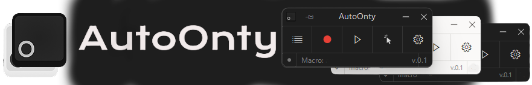

    <kbd>🪶 Only ~834 KB </kbd>
    <kbd>⚡ Sleek & Fast</kbd>
    <kbd>📂 Open Source</kbd>
      
    
     <h1 align="center">&nbsp;&nbsp;&nbsp;&nbsp; $\Huge{\textsf{AutoOnty}}$ <kbd>v1.6.1</kbd></h1>
    
<b>Clean, fast, and simple macro recorder for Windows.</b> 
    <i>A fresh, modern, and open-source alternative to TinyTask.</i>

    <a href="https://github.com/Myzoxxfr/AutoOnty/releases/tag/v1.6.1"><b><kbd>   Current Release v1.6.1 🎉   </kbd></b></a>
    <a href="#quick-start"><b><kbd>   ⚡ Quick Start   </kbd></b></a>
    <a href="#features"><b><kbd>   ✨ Features   </kbd></b></a>
    <a href="#autoonty-vs-tinytask"><b><kbd>   📊 Comparison   </kbd></b></a>
    <a href="#how-to-build"><b><kbd>   🛠️ Building   </kbd></b></a>
    <h2></h2>

## What is AutoOnty?

> **AutoOnty is a fork of [OntyTask](https://github.com/Agzes/OntyTask) by Agzes.** Modified from OntyTask v0.1.0 by Myzoxx, October 2026. Licensed under GPLv3. All credit for the original app goes to the original author.

> ### 🤖 Disclaimer: yes, it's vibecoded
>
> Yeah, I vibecoded it. Sorry, guys. 🫡
>
> The stuff added on top of OntyTask (autoclicker, macro library and editor, record filters, and the rest of my changes) was written with an AI assistant. It builds and runs for me, and I test it. Don't just take my word for anything: the source is GPL-3 and right here, so read it, build it yourself, or open an issue when it breaks.

**AutoOnty** is a lightweight, zero-install macro recorder for Windows. Inspired by TinyTask, it’s open source, packs more features, and offers a modern interface.

---

## What's new in v1.6.1

- Autoclick from one or multiple saved images, captured from the screen or imported from a file. Each image has its own click destination, interval, duration and click count.
- Use X1/X2 side buttons for autoclicking, and choose independently whether to record them in macros.
- Manage saved images separately from enabling recognition. Recognition starts off each launch; your image selection is remembered.
- Settings and autoclick images now live in `Documents\AutoOnty`. Existing files beside the app are imported when no new copy exists, with originals retained.
- Fix the image checkbox closing its dialog, and improve exit handling and graphics cleanup.

## Features

- **Hold-to-click & position jitter**: Tick Toggle Mode to click while holding the hotkey; optional circular position jitter (1–50 pixels) works in fixed and cursor modes.
- **Window targets**: Separate saved application lists for playback and autoclick. Playback uses keyboard focus; autoclick detects the app under the mouse and waits elsewhere without consuming repeats.

- **Records Everything**: Clicks, drags, vertical/horizontal mouse wheel scrolls and typing.
- **Macro Library & Editor**: Click the list button to see your saved macros (stored in `Documents\AutoOnty`), load, rename, delete or edit them. The editor lets you add/change/delete keys, capture mouse clicks at the cursor position, move events and set exact delays (every pause is its own Delay row), with **Undo / Redo** (<kbd>Ctrl+Z</kbd> / <kbd>Ctrl+Y</kbd>) for every edit. With 6+ macros a search box appears. Recordings are only saved when you press Save and name them.
- **Universal Hotkeys**: Rebind Record and Play to any single key (<kbd>F8</kbd>, <kbd>PrtScn</kbd>) or **custom modifier combo**.
- **Macro Hotkeys**: Give every saved macro its own load key (e.g. <kbd>F5</kbd> loads it, your Play hotkey plays it).
- **Flexible Speeds**: Slow it down (`0.5x`), keep it real-time (`1x`), speed it up (`up to 100x Turbo`), instant mode, or custom (`0.01x` to `1000x`).
- **Autoclick**: Built-in autoclicker with its own hotkey. Click at the cursor or at a saved position, with custom interval (optional random jitter), mouse button (including X1/X2), single/double click, and repeat count. Image recognition adds a saved image list with separate intervals and limits.
- **Playback Loops**: Quick presets (`1`, `2`, `3`, `5`, `10`, `100`...), loop forever (`∞`), or set an exact count. The general Speed / Loops settings are the default for every macro, and each macro can override them in the macro library (**Settings...**).
- **Pause / Resume**: Pause macro playback with a configurable hotkey (default **Ctrl+Shift+Alt+H**, with a fallback if already assigned). Held keys and mouse buttons are released while paused and restored on resume.
- **Start Countdowns**: Separate 0–60 second countdowns for macro playback and autoclicking, both off by default. Macro countdown is a direct menu setting; autoclick countdown is in Autoclick settings.
- **Selection Playback**: Play selected actions once with their delays kept, with an optional 0–60 second countdown. The editor stays open with editing locked and a Stop button.
- **Edit Mode**: Bulk edit keys, mouse, coordinates, wheel and delays with multi-select. **Exclusions** skip specific inputs during Play selected and **Visibility** overrides the editor filters per macro. [Details](wiki/Playback-and-Editing.md)
- **Emergency Stop**: Rebindable panic stop key (default <kbd>Pause</kbd>) or physical mouse movement.
- **Smart Status Bar**: Floating on-screen HUD that shows real-time progress and dodges your mouse cursor. Optional start/stop beep.
- **System Tray Support**: Minimize to tray with quick controls, theme matching, and auto-minimize option.
- **Clean Themes**: Dark mode, Light mode, and Windows Acrylic blur.
- **File Association**: AutoOnty automatically registers `.onty` files when launched. Double-click a macro to open it in AutoOnty.
- **Multi-Language**: Built-in English, plus custom JSON translations.

---

## AutoOnty vs TinyTask

| Feature               |    TinyTask (v1.77)     |       AutoOnty (v1.6.1)       | Notes                                                        |
| :-------------------- | :---------------------: | :-------------------------: | :----------------------------------------------------------- |
| **License**           | Proprietary, abandoned  |   **Open Source (GPL-3)**   | 100% Transparent                                             |
| **Input Capture**     |   10ms Timer Polling    |    **Hooks + Raw Input**    | Event-driven capture instead of a timer loop                 |
| **Standalone .EXE**   |         ~ Yes           |      ✕ No (by design)       | Uses .onty files for saving macros and easy sharing         |
| **Hotkeys**           |    Preset list only     |    **Any key or combo**     | Full custom rebinding                                        |
| **Emergency Stop**    |        Fixed key        |      **Configurable**       | Rebindable key (default Pause) or mouse move                 |
| **Macro Library**     |          ✕ No          |       **✓ Built-in**        | Load, rename, delete saved macros (`Documents\AutoOnty`)     |
| **Macro Editor**      |          ✕ No          |          **✓ Yes**          | Edit keys and delays after recording, with undo / redo       |
| **Macro Hotkeys**     |          ✕ No          |          **✓ Yes**          | Each saved macro can have its own load key                   |
| **Record Filters**    |          ✕ No          |          **✓ Yes**          | Choose what to record: mouse move, clicks, wheel             |
| **File Format**       |      Binary `.rec`      |     **JSON (`.onty`)**      | Human-readable and editable                                  |
| **Themes & UI**       |      Classic Win32      | **Dark / Light / Acrylic**  | Modern look and vector UI                                    |
| **Status Overlay**    |     Title text only     |      **Floating HUD**       | Dodges your cursor so it never gets in the way               |
| **Languages**         |        English*      | **English + JSON**          | Switchable on the fly                                           |
| **File Size**         |       **~35 KB**        |          ~834 KB            | AutoOnty includes UI themes & more features                  |

\* Official localized builds existed in the past but are no longer distributed.

---

## Quick Start

### Default Shortcuts

| Action            |                          Default Shortcut                          | Notes                                                     |
| :---------------- | :----------------------------------------------------------------: | :-------------------------------------------------------  |
| **Record / Stop** | <kbd>Ctrl</kbd> + <kbd>Shift</kbd> + <kbd>Alt</kbd> + <kbd>R</kbd> | Starts/stops recording (can be changed to anything else)  |
| **Play / Stop**   | <kbd>Ctrl</kbd> + <kbd>Shift</kbd> + <kbd>Alt</kbd> + <kbd>P</kbd> | Starts/stops playback (can be changed to anything else)   |
| **Pause / Resume** | <kbd>Ctrl</kbd> + <kbd>Shift</kbd> + <kbd>Alt</kbd> + <kbd>H</kbd> | Pauses/resumes playback; uses a fallback if already assigned |
| **Autoclick**     | <kbd>Ctrl</kbd> + <kbd>Shift</kbd> + <kbd>Alt</kbd> + <kbd>A</kbd> | Starts/stops the autoclicker (can be changed)             |
| **Set Click Pos** | <kbd>Ctrl</kbd> + <kbd>Shift</kbd> + <kbd>Alt</kbd> + <kbd>S</kbd> | Saves the cursor position for fixed-position autoclick    |
| **Panic Stop**    |                  <kbd>Pause</kbd> (rebindable)                     | Instantly stops playback or autoclick if you need to abort|
| **Save macro**    |                    <kbd>Ctrl</kbd> + <kbd>S</kbd>                  | Saves the current macro (asks for a name the first time)  |
| **Open file**     |                    <kbd>Ctrl</kbd> + <kbd>O</kbd>                  | Opens a `.onty` file from anywhere on your PC             |

### How to Use

1. **Record**: Hit the Record shortcut (or click the red circle). Do your actions with mouse and keyboard.
2. **Stop**: Hit the Record shortcut again (or click Stop).
3. **Play**: Hit the Play shortcut (or click Play) to watch it run.
4. **Save**: Click the save icon at the bottom left of the window (or press <kbd>Ctrl</kbd> + <kbd>S</kbd>), name your macro, and it is stored as a `.onty` file in `Documents\AutoOnty`.
5. **Macros**: Click the **Macros** tile to load, rename, delete or edit your saved macros.
6. **Settings**: Click Menu (or right-click) to change playback speed, loop count, hotkeys, which inputs to record, theme, and more.

---

Autoclick images and `AutoclickImages.onty` are stored in **Documents\AutoOnty\ImageDetections**; general settings use **Documents\AutoOnty\AutoOnty.ini**. Existing files beside the app are imported when no Documents copy exists. Image recognition starts disabled on every launch, while selected images remain saved.

Choose **Menu -> Macro settings -> Image recognition macro...** to create a watcher without recording keys. First choose a screenshot or BMP/PNG/JPG file. The themed editor lets you click, auto click, run a saved macro or just wait; choose where, how often and for how long, plus continue/pause/stop outcomes. **Start watching** runs it; **Save macro...** keeps it for later.

The existing editor's **Add image** button remains. Select an image row and choose **Image settings...** or double-click to edit it. `0` means no timeout, and large values such as `9999999` are supported. The status bar now explains searching, matching, repeating and timeout/pause states.

The native release is **853,504 bytes (~834 KB)**. The portable **AutoOnty.exe** uses native matching, Win32 capture and GDI+ UI/image import, with no extra runtime downloads. Keep the generated `ImageDetections` folder with saved macros. See [the image guide](wiki/Playback-and-Editing.md#image-recognition) and [build details](wiki/How-To-Build.md#image-matching-checks).

---

## How to Build

If you want to compile AutoOnty yourself:

1. Install **Visual Studio** with the **Desktop development with C++** workload.
2. Double-click `AutoOnty.slnx` to open it.
3. Set the mode to **Release** (and **x64**) in the toolbar, then press <kbd>Ctrl</kbd> + <kbd>Shift</kbd> + <kbd>B</kbd>.

Your `.exe` file will be generated in `bin/x64/`.

---

## Wiki & Guides

Check out the full [Wiki](wiki/) for more details and guides:

- 🚀 [Getting Started Guide](wiki/Getting-Started.md) - First steps and interface guide.
- 🎮 [Macro Engine & How recording and playback work](wiki/Engine.md) - How the macros work.
- ✏️ [Playback & Editing](wiki/Playback-and-Editing.md) - Pause, countdowns, selection playback and editor filters.
- 🖱️ [Autoclick & Image Recognition](wiki/Autoclick.md) - Toggle mode, jitter, random timing and more.
- ⌨️ [Hotkeys & Controls](wiki/Hotkeys.md) - Shortcuts and emergency stop settings.
- 🎨 [Themes & Customization](wiki/Settings.md) - Dark mode, Acrylic blur, and status bar.
- 📄 [The .onty File Format](wiki/Onty-Macro-Format.md) - How macros are stored in JSON.
- 🌐 [Languages & Translations](wiki/Translations.md) - Adding custom languages.
- 📋 [Translation Table & Words](wiki/Translation-Table.md) - All words and text keys.
- 🤖 [Command Line & Automation](wiki/CLI-Automation.md) - Run macros from batch files or shortcuts.

---

     
    <b>AutoOnty</b>, a fork of <b>OntyTask</b> by Agzes (<b>O</b>pe<b>N</b> <b>T</b>in<b>Y</b> <b>TASK</b>) - <i>Simple, Polished, and Open-Source Automation.</i> 
    Licensed under <a href="LICENSE">GNU General Public License v3.0</a>.

