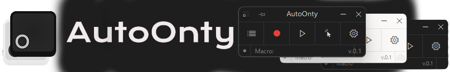

    <kbd>🪶 Only ~570 KB </kbd>
    <kbd>⚡ Clean & Fast</kbd>
    <kbd>📂 100% Open Source</kbd>
      
    
     <h1 align="center">&nbsp;&nbsp;&nbsp;&nbsp; $\Huge{\textsf{AutoOnty}}$ <kbd>v1.2</kbd></h1>
    
<b>Sleek, fast, and simple macro recorder for Windows.</b> 
    <i>A fresh, modern, and open-source alternative to TinyTask.</i>

    <a href="https://github.com/Myzoxxfr/AutoOnty/releases/tag/v1.2"><b><kbd>   Current Release v1.2 🎉   </kbd></b></a>
    <a href="#quick-start"><b><kbd>   ⚡ Quick Start   </kbd></b></a>
    <a href="#features"><b><kbd>   ✨ Features   </kbd></b></a>
    <a href="#autoonty-vs-tinytask"><b><kbd>   📊 Comparison   </kbd></b></a>
    <a href="#how-to-build"><b><kbd>   🛠️ Building   </kbd></b></a>
    <h2></h2>

## What is AutoOnty?

> **AutoOnty is a fork of [OntyTask](https://github.com/Agzes/OntyTask) by Agzes.** Modified from OntyTask v0.1.0 by Myzoxx, October 2026. Licensed under GPLv3. All credit for the original app goes to the original author.

> ### 🤖 Disclaimer: yes, it's vibecoded
>
> Yeah, I vibecoded it. Sorry, guys. 🫡
>
> The stuff added on top of OntyTask (autoclicker, macro library and editor, record filters, and the rest of my changes) was written with an AI assistant (Claude). It builds and runs for me, and I test it. Don't just take my word for anything: the source is GPL-3 and right here, so read it, build it yourself, or open an issue when it breaks.

**AutoOnty** is a lightweight, zero-install macro recorder for Windows. Inspired by TinyTask, it’s open source, packs more features, and offers a modern interface.

---

## Features

- **Records Everything**: Clicks, drags, mouse wheel scrolls and typing.
- **Macro Library & Editor**: Click the list button to see your saved macros (stored in `Documents\AutoOnty`), load, rename, delete or edit them. The editor lets you add/change/delete keys, move events and set exact delays (every pause is its own Delay row), with **Undo / Redo** (<kbd>Ctrl+Z</kbd> / <kbd>Ctrl+Y</kbd>) for every edit. With 6+ macros a search box appears. Recordings are only saved when you press Save and name them.
- **Universal Hotkeys**: Rebind Record and Play to any single key (<kbd>F8</kbd>, <kbd>PrtScn</kbd>) or **custom modifier combo**.
- **Macro Hotkeys**: Give every saved macro its own load key (e.g. <kbd>F5</kbd> loads it, your Play hotkey plays it).
- **Flexible Speeds**: Slow it down (`0.5x`), keep it real-time (`1x`), speed it up (`up to 100x Turbo`), instant mode, or custom (`0.01x` to `1000x`).
- **Autoclick**: Built-in autoclicker with its own hotkey. Click at the cursor or at a saved position, with custom interval (optional random jitter), mouse button, single/double click, and repeat count.
- **Playback Loops**: Quick presets (`1`, `2`, `3`, `5`, `10`, `100`...), loop forever (`∞`), or set an exact count. The general Speed / Loops settings are the default for every macro, and each macro can override them in the macro library (**Settings...**).
- **Emergency Stop**: Rebindable panic stop key (default <kbd>Pause</kbd>) or physical mouse movement.
- **Smart Status Bar**: Floating on-screen HUD that shows real-time progress and dodges your mouse cursor. Optional start/stop beep.
- **System Tray Support**: Minimize to tray with quick controls, theme matching, and auto-minimize option.
- **Clean Themes**: Dark mode, Light mode, and Windows Acrylic blur.
- **File Association**: Turn on **Associate .onty files** in the menu, then double-click any `.onty` file to open it straight in AutoOnty.
- **Multi-Language**: Built-in English and Russian, plus custom JSON translations.

---

## AutoOnty vs TinyTask

| Feature               |    TinyTask (v1.77)     |       AutoOnty (v1.2)       | Notes                                                        |
| :-------------------- | :---------------------: | :-------------------------: | :----------------------------------------------------------- |
| **License**           | Proprietary, abandoned  |   **Open Source (GPL-3)**   | 100% Transparent                                             |
| **Input Capture**     |   10ms Timer Polling    |    **Hooks + Raw Input**    | Event-driven capture instead of a timer loop                 |
| **Standalone .EXE**   |         ~ Yes           |      ✕ No (by design)       | Uses .onty files for saving macros and easy sharing         |
| **Hotkeys**           |    Preset list only     |    **Any key or combo**     | Full custom rebinding                                        |
| **Emergency Stop**    |        Fixed key        |      **Configurable**       | Rebindable key (default Pause) or mouse move                 |
| **Macro Library**     |          ✕ No          |       **✓ Built-in**        | Load, rename, delete saved macros (`Documents\AutoOnty`)     |
| **Macro Editor**      |          ✕ No          |          **✓ Yes**          | Edit keys and delays after recording, with undo / redo       |
| **Macro Hotkeys**     |          ✕ No          |          **✓ Yes**          | Each saved macro can have its own load key                   |
| **Record Filters**    |          ✕ No          |          **✓ Yes**          | Choose what to record: mouse move, clicks, wheel             |
| **File Format**       |      Binary `.rec`      |     **JSON (`.onty`)**      | Human-readable and editable                                  |
| **Themes & UI**       |      Classic Win32      | **Dark / Light / Acrylic**  | Modern look and vector UI                                    |
| **Status Overlay**    |     Title text only     |      **Floating HUD**       | Dodges your cursor so it never gets in the way               |
| **Languages**         |        English‡         | **English, Russian + JSON** | Switchable on the fly                                        |
| **File Size**         |       **~35 KB**        |          ~570 KB            | AutoOnty includes UI themes & more features                  |

‡ Official localized builds existed in the past but are no longer distributed.

---

## Quick Start

### Default Shortcuts

| Action            |                          Default Shortcut                          | Notes                                                     |
| :---------------- | :----------------------------------------------------------------: | :-------------------------------------------------------  |
| **Record / Stop** | <kbd>Ctrl</kbd> + <kbd>Shift</kbd> + <kbd>Alt</kbd> + <kbd>R</kbd> | Starts/stops recording (can be changed to anything else)  |
| **Play / Stop**   | <kbd>Ctrl</kbd> + <kbd>Shift</kbd> + <kbd>Alt</kbd> + <kbd>P</kbd> | Starts/stops playback (can be changed to anything else)   |
| **Autoclick**     | <kbd>Ctrl</kbd> + <kbd>Shift</kbd> + <kbd>Alt</kbd> + <kbd>A</kbd> | Starts/stops the autoclicker (can be changed)             |
| **Set Click Pos** | <kbd>Ctrl</kbd> + <kbd>Shift</kbd> + <kbd>Alt</kbd> + <kbd>S</kbd> | Saves the cursor position for fixed-position autoclick    |
| **Panic Stop**    |                  <kbd>Pause</kbd> (rebindable)                     | Instantly stops playback or autoclick if you need to abort|
| **Save macro**    |                    <kbd>Ctrl</kbd> + <kbd>S</kbd>                  | Saves the current macro (asks for a name the first time)  |
| **Open file**     |                    <kbd>Ctrl</kbd> + <kbd>O</kbd>                  | Opens a `.onty` file from anywhere on your PC             |

### How to Use

1. **Record**: Hit the Record shortcut (or click the red circle). Do your actions with mouse and keyboard.
2. **Stop**: Hit the Record shortcut again (or click Stop).
3. **Play**: Hit the Play shortcut (or click Play) to watch it run.
4. **Save**: Click the save icon at the bottom left of the window (or press <kbd>Ctrl</kbd> + <kbd>S</kbd>), name your macro, and it is stored as a `.onty` file in `Documents\AutoOnty`.
5. **Macros**: Click the **Macros** tile to load, rename, delete or edit your saved macros.
6. **Settings**: Click Menu (or right-click) to change playback speed, loop count, hotkeys, which inputs to record, theme, and more.

---

## How to Build

If you want to compile AutoOnty yourself:

1. Install **Visual Studio** with the **Desktop development with C++** workload.
2. Double-click `AutoOnty.slnx` to open it.
3. Set the mode to **Release** (and **x64**) in the toolbar, then press <kbd>Ctrl</kbd> + <kbd>Shift</kbd> + <kbd>B</kbd>.

Your `.exe` file will be generated in `bin/x64/`.

---

## Wiki & Guides

Check out the full [Wiki](wiki/) for more details and guides:

- 🚀 [Getting Started Guide](wiki/Getting-Started.md) - First steps and interface guide.
- 🎮 [Macro Engine & How recording and playback work](wiki/Engine.md) - How the macros work.
- ⌨️ [Hotkeys & Controls](wiki/Hotkeys.md) - Shortcuts and emergency stop settings.
- 🎨 [Themes & Customization](wiki/Settings.md) - Dark mode, Acrylic blur, and status bar.
- 📄 [The .onty File Format](wiki/Onty-Macro-Format.md) - How macros are stored in JSON.
- 🌐 [Languages & Translations](wiki/Translations.md) - Adding custom languages.
- 📋 [Translation Table & Words](wiki/Translation-Table.md) - All words and text keys.
- 🤖 [Command Line & Automation](wiki/CLI-Automation.md) - Run macros from batch files or shortcuts.

---

     
    <b>AutoOnty</b>, a fork of <b>OntyTask</b> by Agzes (<b>O</b>pe<b>N</b> <b>T</b>in<b>Y</b> <b>TASK</b>) - <i>Simple, Polished, and Open-Source Automation.</i> 
    Licensed under <a href="LICENSE">GNU General Public License v3.0</a>.

